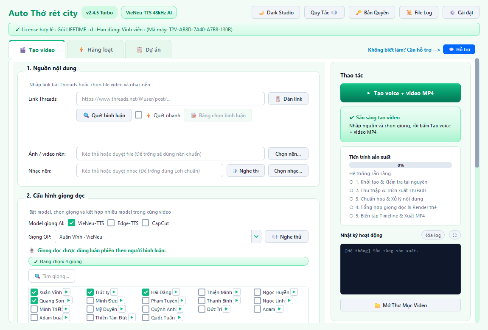
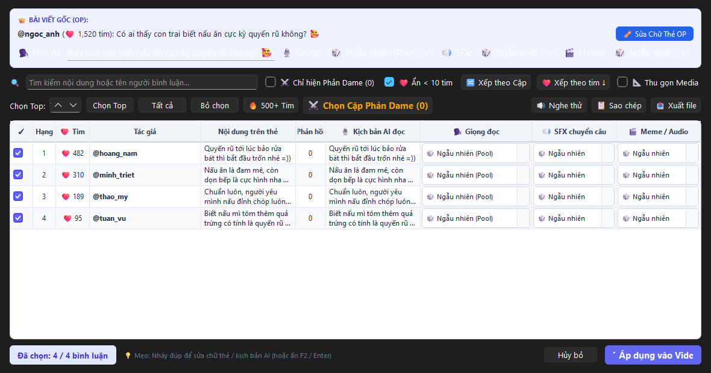

# 🎬 Thờ Rét City Studio (v2.4.5 Turbo)

[](https://github.com/vantaii-cc/thorets/releases/latest)
[](https://github.com/vantaii-cc/thorets/releases/latest)
[](https://github.com/vantaii-cc/thorets/releases/latest)
[](https://github.com/vantaii-cc/thorets)

> **Phần mềm máy trạm hỗ trợ nhà sáng tạo nội dung chuyển đổi các câu chuyện, tâm sự và bài viết thảo luận thành video ngắn dạng thẻ bài sinh động chuẩn 9:16 với giọng đọc AI tiếng Việt tự nhiên và hiệu ứng âm thanh cuốn hút.**

---

### 📥 Tải Về Ứng Dụng (Trải Nghiệm Miễn Phí 24 Giờ)

Bấm vào liên kết bên dưới để tải trực tiếp gói cài đặt chính thức dành cho Windows:

### 👉 **[⬇️ TẢI XUỐNG THỜ RÉT CITY STUDIO CHO WINDOWS (v2.4.5)](https://github.com/vantaii-cc/thorets/releases/download/v2.4.5/Threads2Video_Setup_v2.4.5.exe)**

* ⚡ **Dung lượng:** ~137 MB (Biên dịch C++ độc lập, chạy mượt mà ngay trên máy tính)
* 🕒 **Cài đặt siêu nhanh:** ~10 giây
* 🎁 **Chính sách trải nghiệm:** Tự động kích hoạt **24 giờ dùng thử đầy đủ tính năng** ngay lần đầu mở ứng dụng.

---

### 🖥️ Giao Diện Biên Tập Thực Tế

#### 1. Màn hình làm việc chính (Thiết lập nội dung & Giọng đọc AI)


#### 2. Không gian biên tập nội dung thông minh (Hội thoại, Gắn giọng, SFX & Meme)


---

### ✨ Những Tính Năng Sáng Tạo Nổi Bật

* **🚀 Biên tập nội dung nhanh chóng:** Tiếp nhận nội dung văn bản chia sẻ, hỗ trợ định dạng thẻ bài viết bắt mắt, tích hợp thuyết minh giọng đọc AI và xuất video mượt mà.
* **🎙️ Thuyết minh AI tiếng Việt đa dạng:** Tích hợp bộ 3 công nghệ giọng đọc hàng đầu (VieNeu-TTS 48kHz, CapCut AI, Edge TTS) với hàng chục chất giọng nam/nữ Bắc - Trung - Nam tự nhiên và truyền cảm.
* **💬 Định dạng hội thoại đối đáp:** Hỗ trợ sắp xếp mạch câu chuyện đối đáp tương tác thông minh, làm nổi bật các góc nhìn thú vị trong thảo luận để giữ chân người xem.
* **🎭 Âm thanh sinh động & Chống lấn giọng (Audio Ducking):** Tự động phối ghép nhạc nền, chèn hiệu ứng âm thanh SFX chuyển ý và meme vui nhộn, tự động giảm nhỏ âm lượng nhạc nền khi có lời đọc.
* **⚡ Quy trình làm việc liên tục (Multi-Project Workflow):** Hỗ trợ chuẩn bị danh sách nhiều kịch bản câu chuyện để sản xuất liên tục, tối ưu thời gian sáng tạo nội dung.
* **🎬 Xuất dự án tương thích CapCut PC / JianYing Pro:** Tự động tạo sẵn file project CapCut đầy đủ các lớp timeline (video nền, thẻ ảnh, giọng đọc, nhạc nền, SFX) để bạn tiếp tục sáng tạo nếu muốn.

---

### 📖 3 Bước Tạo Video Kể Chuyện

1. **Nhập liên kết bài viết:** Sao chép liên kết câu chuyện, bài thảo luận công khai cần làm video và dán vào ứng dụng.
2. **Tùy chỉnh giọng đọc & Hội thoại:** Lựa chọn giọng AI ưng ý, lọc các ý kiến hay hoặc chọn cặp hội thoại đối đáp.
3. **Xuất video hoàn chỉnh:** Bấm `Tạo voice + video MP4` (hoặc `Xuất CapCut Draft`) và nhận video chất lượng cao sẵn sàng chia sẻ.

---

### 🛠 Hướng Dẫn Vượt Microsoft Defender SmartScreen

Do đây là phần mềm mới phát hành và chưa tích lũy chứng chỉ danh tiếng từ Microsoft, Windows có thể hiển thị thông báo màn hình xanh bảo vệ *(Windows protected your PC)*:

1. Bấm vào dòng chữ **More info** (hoặc *Thông tin thêm*).
2. Bấm nút **Run anyway** (hoặc *Vẫn chạy*) để mở trình cài đặt bình thường.

---

### 🛡️ Cam Kết An Toàn & Bảo Mật Tuyệt Đối (Local-First)

* **Xử lý 100% cục bộ (Local-First):** Toàn bộ quy trình đồ họa, xử lý âm thanh và kết xuất video đều diễn ra hoàn toàn trên thiết bị của bạn.
* **Không thu thập dữ liệu (Zero Telemetry):** Phần mềm không gửi bất kỳ thông tin cá nhân, nội dung sáng tạo hay tệp tin nào của bạn về máy chủ bên ngoài.
* **Mã hóa phần cứng Windows DPAPI:** Dữ liệu cấu hình cục bộ được bảo vệ bởi lớp mã hóa DPAPI an toàn của hệ điều hành Windows.

---

### ⚖️ Tuyên Bố Miễn Trừ Trách Nhiệm & Tuân Thủ Bản Quyền (Legal Disclaimer)

* **Nhãn hiệu độc lập:** Các nhãn hiệu thương mại được nhắc đến thuộc quyền sở hữu của các tổ chức chủ quản tương ứng. Thờ Rét City Studio là công cụ máy trạm độc lập hỗ trợ biên tập đa phương tiện cho nhà sáng tạo nội dung.
* **Nguyên tắc Sử dụng Hợp lý (Fair Use):** Phần mềm tiếp nhận các bài thảo luận công khai nhằm phục vụ mục đích sáng tạo nội dung phái sinh, bình luận, chia sẻ kiến thức và giải trí phù hợp với nguyên tắc Fair Use và pháp luật hiện hành.
* **Trách nhiệm người dùng:** Người sáng tạo nội dung chịu trách nhiệm về nội dung xuất bản và phân phối trên các nền tảng mạng xã hội.

---

### 🔒 Thông Tin Kiểm Tra Tệp Tin Phát Hành

<details>
<summary><b>👉 Xem mã SHA-256 đối chiếu tính toàn vẹn (Checksum)</b></summary>

```text
File: Threads2Video_Setup_v2.4.5.exe
SHA256: 8db3e37e37db92cab255a3530d596189887534dc3ada88d4be64d3a8cd46afb8
Chữ ký số: Ed25519 (Verified)
```
*(Mã băm SHA-256 là dấu vân tay điện tử một chiều tiêu chuẩn quốc tế giúp bạn đối chiếu tính nguyên vẹn của tệp tải về, đảm bảo tệp sạch và không bị lỗi đường truyền).*
</details>

---

### 📞 Kênh Hỗ Trợ & Kích Hoạt Bản Quyền

* 💬 **Zalo hỗ trợ sáng tạo nội dung 24/7:** [**0777762532** (Bấm để chat Zalo)](https://zalo.me/0777762532)
* 🔑 **Kích hoạt bản quyền:** Sau khi hết 24 giờ dùng thử, gửi **Mã máy (Machine ID)** hiển thị trên góc ứng dụng qua Zalo để nhận mã kích hoạt sử dụng lâu dài.
